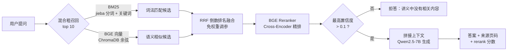

# course-rag · 课程讲义智能问答助手

上传课程 PDF 讲义，针对讲义内容提问，系统**只依据讲义原文回答、标注来源页码，讲义里没有的内容会明确拒答**——避免大模型"一本正经地胡说八道"。

本项目从零实现了一套完整的 RAG（检索增强生成）系统，并通过**自建 35 题评测集**驱动迭代：纯向量检索基线 77.1% → 引入 BM25 混合检索 82.9% → 加入 Rerank 精排后 **100%**。

- 🧠 混合检索（向量 + BM25 双路召回，RRF 融合）+ Cross-Encoder 重排序
- 📄 PDF 解析、流式输出、来源页码标注、讲义外问题拒答
- 📊 35 题评测集驱动优化，检索准确率 77.1% → 100%，全流程可复现
- 🚀 FastAPI 服务化 + Docker 容器化，一条命令启动，自带在线接口文档

---

## 在线演示

🚀 **公网地址：<https://course-rag.onrender.com>**

> 部署在 **Render 免费版**（美国节点，Docker 容器化），代码即本仓库 `master` 分支。
>
> - 免费实例闲置约 15 分钟会自动休眠，**首次打开需等待约 50 秒冷启动**（页面加载慢属正常现象，稍等即可）。
> - 可直接验证两类能力：讲义内问题（如「死锁的四个必要条件是什么？」）会回答并标注来源页码；讲义外问题（如「宫保鸡丁怎么做？」）会明确拒答。
> - 部署专用 `Dockerfile.cloud`，构建细节见文末「公网部署说明（Render）」。

---

## 效果：评测集驱动的三次迭代

基于 `evals/questions.jsonl`（30 道讲义内题，标注正确页码；5 道讲义外题，应拒答）：

| 检索方案 | Top1 准确率 | Recall@5 | 讲义外拒答率 | 综合正确率 |
| --- | --- | --- | --- | --- |
| 纯向量检索（基线） | 76.7% (23/30) | 100% | 80% (4/5) | 77.1% |
| 向量 + BM25，RRF 融合 | 83.3% (25/30) | 100% | 80% (4/5) | 82.9% |
| **混合召回 + Rerank 精排** | **100% (30/30)** | **100%** | **100% (5/5)** | **100%** |

**每一步优化都来自对错误的分析，而不是盲目堆模型：**

1. 基线的 7 道排序错题**全部是术语/关键词型**：如"银行家算法用来干什么"被含"算法"二字的调度页抢走；"多个进程互相等待都无法推进"（没出现"死锁"二字）没命中死锁页——这是纯向量语义检索的固有短板。
2. 加入 BM25 补上**字面精确匹配**，修好 2 道（+6.6pct）；两路用 RRF 倒数排名融合，无需人工调权重。
3. Recall@5 始终 100%，说明粗召回已充分、瓶颈只在排序——这是引入 Rerank 的前提判断。
4. Rerank（Cross-Encoder）把问题与每个候选块直接配对打分，精度远高于"向量空间算距离"，Top1 拉到 100%。
5. **拒答双阈值**：Rerank 置信度实测讲义内 > 0.75、讲义外 < 0.001，取阈值 0.1，间隔极大、判据可靠；无 Rerank 时自动退回向量距离阈值 0.55。

---

## 系统架构



**关键设计：**

- **粗召回（Recall）与精排（Precision）解耦**：先用便宜的向量 + BM25 多路召回保证不漏，再用贵但准的 Cross-Encoder 只对 10 个候选精排，兼顾效果与成本。
- **拒答机制**：不是所有问题都该回答。检索置信度低于阈值直接拒答，把"幻觉"挡在生成之前。
- **RRF 融合**：`score = Σ 1/(k+rank)`，两路分数尺度不同也无需归一化、无需调权重（k=60）。

---

## 快速开始

### 方式一：Docker（推荐，一条命令）

```bash
# 构建镜像（海外网络 / 标准方式）
docker build -t course-rag:local .

# 运行（密钥在运行时通过环境变量注入，不打进镜像；首次启动自动索引 data/ 下的 PDF）
docker run -d --name course-rag -p 8000:8000 --env-file .env course-rag:local

# 约 20 秒后访问：http://localhost:8000/docs （在线接口文档）
```

> 📌 **国内网络（拉取 Docker Hub / ghcr.io 超时）**：改用仓库内的 `Dockerfile.cn`——除基础镜像走 DaoCloud 公开代理外，依赖与逻辑与 `Dockerfile` 完全一致；Python 依赖仍走 `uv.lock` 锁定的国内源：
>
> ```bash
> # 国内网络构建（只需把 build 换成这一行）
> docker build -f Dockerfile.cn -t course-rag:local .
>
> # 数据持久化（可选，推荐）：挂载命名卷保存索引与资料，重建容器不丢
> docker run -d --name course-rag -p 8000:8000 \
>   -v course-rag-db:/app/chroma_db -v course-rag-data:/app/data \
>   --env-file .env course-rag:local
> ```
>
> 常用容器命令：`docker logs -f course-rag`（看日志）、`docker stop/start course-rag`（停/启）、`docker rm -f course-rag`（删除容器）。

### 方式二：本地运行（uv 管理环境）

```bash
# 1. 安装依赖（uv 自动创建虚拟环境）
uv sync

# 2. 配置密钥
cp .env.example .env
#   在 .env 中填入 SILICONFLOW_API_KEY（硅基流动免费申请）

# 3a. 启动 FastAPI 接口服务（启动时自动建索引）
uv run uvicorn course_rag.api:app --host 0.0.0.0 --port 8000

# 3b. 或启动 Gradio 网页界面
uv run python -m course_rag.app
#   访问 http://127.0.0.1:7860
```

> 模型均通过硅基流动 SiliconFlow 的 OpenAI 兼容接口调用：对话 `Qwen/Qwen2.5-7B-Instruct`、向量 `BAAI/bge-large-zh-v1.5`、重排序 `BAAI/bge-reranker-v2-m3`。

---

## API 接口

| 方法 | 路径 | 说明 |
| --- | --- | --- |
| GET | `/health` | 健康检查，返回服务状态与已索引块数 |
| POST | `/api/ask` | 非流式问答，返回完整答案 + 来源页码 + rerank 分数 |
| POST | `/api/ask/stream` | 流式问答，逐字返回（打字机效果） |
| POST | `/api/index` | 上传 PDF 建立索引（multipart/form-data） |

`POST /api/ask` 响应示例：

```json
{
  "answer": "产生死锁的四个必要条件是：1. 互斥条件 2. 请求并保持条件 3. 不可剥夺条件 4. 循环等待条件",
  "sources": [
    {"source": "lecture.pdf", "page": 7, "rerank_score": 0.9984}
  ]
}
```

---

## 复现评测

```bash
uv run python -m course_rag.evaluate
```

输出三种检索方案（纯向量 / BM25 混合 / Rerank 精排）在 35 题上的 Top1、Recall@5、拒答率与综合正确率，结果记录于 `evals/benchmark.md`。

---

## 项目结构

```
course-rag/
├── src/course_rag/
│   ├── rag_engine.py      # 核心引擎：混合检索 + RRF 融合 + Rerank + 拒答
│   ├── chunking.py        # 讲义切块（300 字滑窗）
│   ├── document_parser.py # pdfplumber 解析 PDF、保留页码
│   ├── index.py           # 向量化入库 ChromaDB
│   ├── qa.py / chat.py    # 命令行问答 / 多轮对话
│   ├── app.py             # Gradio 网页（流式、来源标注、拒答、上传 PDF）
│   ├── api.py             # FastAPI 四个接口
│   └── evaluate.py        # 三方案对比评测
├── evals/
│   ├── questions.jsonl    # 35 题标注集
│   └── benchmark.md       # 评测结果与错误分析
├── data/                  # 示例讲义（7 页 PDF）
├── Dockerfile             # 容器化（分层缓存、健康检查、数据卷）
├── Dockerfile.cn          # 国内网络构建版（基础镜像走 DaoCloud 代理）
└── pyproject.toml
```

---

## 技术栈

- **语言/环境**：Python 3.13、uv
- **检索**：ChromaDB（向量库）、BGE-large-zh（向量）、jieba + rank-bm25（词法）、BGE-reranker-v2-m3（重排序）
- **生成**：Qwen2.5-7B-Instruct（硅基流动 OpenAI 兼容接口）
- **服务**：FastAPI、Uvicorn、Gradio
- **部署**：Docker、Docker Desktop（WSL2）
- **解析**：pdfplumber

---

## 开发历程

- [x] **M0 环境搭建**：项目骨架、uv 依赖管理、密钥规范、大模型首次对话
- [x] **M1 最小闭环**：文档切块、向量化、ChromaDB 检索、命令行 RAG 问答
- [x] **M2 产品化**：PDF 解析、抽出 RAGEngine、Gradio 网页、流式输出、来源标注、阈值拒答
- [x] **M3 效果优化与工程化**：
  - [x] 35 题评测集 + 纯向量基线（77.1%）
  - [x] BM25 + 向量混合检索、RRF 融合（82.9%）
  - [x] Rerank 重排序精排（100%）
  - [x] FastAPI 服务化 + Docker 容器化
  - [x] 公网部署（Render 免费版 + 专用 Dockerfile.cloud，公网可访问、讲义内问答与讲义外拒答均验证通过）

---

## 公网部署说明（Render）

本仓库提供两套 Dockerfile，区分本地与云端：

| 文件 | 用途 | 关键点 |
| --- | --- | --- |
| `Dockerfile` / `Dockerfile.cn` | 本地容器 | 暴露 8000 端口跑 FastAPI；`.cn` 版基础镜像走国内代理 |
| `Dockerfile.cloud` | 云平台（Render 等） | 暴露平台注入的 `$PORT`、启动 Gradio 网页、官方源构建 |

**Render 部署要点（免费版 Web Service）：**

1. 代码推到 GitHub（Render 的 Public Git URL 仅支持 GitHub / GitLab / Bitbucket），新建 **Web Service → Docker**，Dockerfile Path 填 `Dockerfile.cloud`，Region 任选（本项目用美国 Ohio）。
2. 在 **Environment** 配置 Secret：`SILICONFLOW_API_KEY=<你的硅基流动密钥>`，密钥不打进镜像。
3. **海外节点的 API 端点坑**：代码默认 `SILICONFLOW_BASE_URL=https://api-st.siliconflow.cn/v1`（硅基流动官方「海外加速端点」，与国内站 `api.siliconflow.cn` 用同一把中国区 key）。注意国际站 `api.siliconflow.com` 是**独立账号体系**，中国区 key 无法使用；如需覆盖可在环境变量里显式设置 `SILICONFLOW_BASE_URL`。
4. 免费实例 0.1 CPU / 512 MB，闲置约 15 分钟休眠、冷启动约 50 秒；启动时会自动从内置 `data/lecture.pdf` 重建索引（约 10 秒）。
5. Render 用 Public Git URL 接入时**不会随 push 自动部署**，每次更新代码后需在控制台 **Manual Deploy → Deploy latest commit**。
